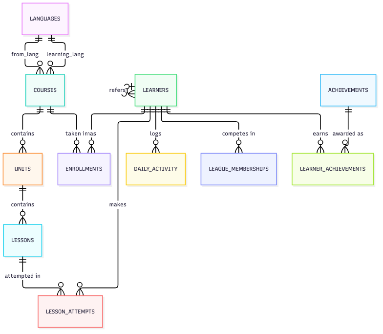

# Phase 1: Schema Design (Team T0037)

## 1. Data Dictionary

| Table | Column | Type | Constraint | Why |
|---|---|---|---|---|
| languages | language_code | CHAR(2) | PK, CHECK `^[a-z]{2}$` | ISO 639-1 two-letter code, always lowercase |
| languages | language_name | VARCHAR(50) | NOT NULL, UNIQUE | Human-readable name |
| courses | course_id | INTEGER | PK | Surrogate key |
| courses | from_lang | CHAR(2) | FK → languages, NOT NULL | Base language of the learner |
| courses | learning_lang | CHAR(2) | FK → languages, NOT NULL | Target language being learned |
| courses | title | VARCHAR(100) | NOT NULL | Display name |
| courses | launched_on | DATE | NOT NULL | Date course went live |
| courses | — | — | UNIQUE(from_lang, learning_lang) | One course per language pair |
| courses | — | — | CHECK from_lang <> learning_lang | Cannot learn a language in itself |
| units | unit_id | INTEGER | PK | Surrogate key |
| units | course_id | INTEGER | FK → courses, NOT NULL | Owning course |
| units | unit_no | SMALLINT | NOT NULL, CHECK > 0 | Ordering within course |
| units | title | VARCHAR(100) | NOT NULL | Display name |
| units | cefr_level | CHAR(2) | NOT NULL, CHECK IN A1…C2 | CEFR proficiency level |
| units | — | — | UNIQUE(course_id, unit_no) | No duplicate unit numbers per course |
| lessons | lesson_id | INTEGER | PK | Surrogate key |
| lessons | unit_id | INTEGER | FK → units, NOT NULL | Owning unit |
| lessons | lesson_no | SMALLINT | NOT NULL, CHECK > 0 | Ordering within unit |
| lessons | lesson_type | VARCHAR(20) | NOT NULL, CHECK IN LEARN/PRACTICE/STORY/LEGENDARY | Actual types found in seed data |
| lessons | xp_value | SMALLINT | NOT NULL, CHECK > 0 | XP awarded on completion |
| lessons | — | — | UNIQUE(unit_id, lesson_no) | No duplicate lesson numbers per unit |
| learners | learner_id | INTEGER | PK | Surrogate key |
| learners | username | VARCHAR(50) | NOT NULL, UNIQUE, CHECK alphanumeric+underscore | Login handle |
| learners | email | VARCHAR(100) | NOT NULL, UNIQUE, CHECK regex | Contact address |
| learners | country_code | CHAR(2) | NOT NULL, CHECK `^[A-Z]{2}$` | ISO 3166-1 alpha-2 |
| learners | daily_goal_xp | SMALLINT | NOT NULL, CHECK IN (10,20,30,50) | App goal settings available |
| learners | subscription | VARCHAR(10) | NOT NULL, DEFAULT 'FREE', CHECK IN FREE/SUPER/MAX | Plan tier |
| learners | referred_by | INTEGER | FK → learners, NULL allowed, ON DELETE SET NULL | Referral chain |
| learners | joined_at | TIMESTAMPTZ | NOT NULL | Account creation time |
| enrollments | learner_id | INTEGER | PK part, FK → learners | The learner |
| enrollments | course_id | INTEGER | PK part, FK → courses | The course |
| enrollments | enrolled_at | TIMESTAMPTZ | NOT NULL | When enrolled |
| enrollments | total_xp | INTEGER | NOT NULL, DEFAULT 0, CHECK >= 0 | Denormalized cumulative XP |
| enrollments | is_active | BOOLEAN | NOT NULL, DEFAULT TRUE | Active/paused flag |
| lesson_attempts | attempt_id | INTEGER | PK | Surrogate key |
| lesson_attempts | learner_id | INTEGER | FK → learners, NOT NULL | Who attempted |
| lesson_attempts | lesson_id | INTEGER | FK → lessons, NOT NULL | Which lesson |
| lesson_attempts | started_at | TIMESTAMPTZ | NOT NULL | Attempt start |
| lesson_attempts | completed_at | TIMESTAMPTZ | NULL = abandoned | Attempt end |
| lesson_attempts | mistakes | SMALLINT | NOT NULL, DEFAULT 0, CHECK >= 0 | Error count |
| lesson_attempts | hearts_lost | SMALLINT | NOT NULL, DEFAULT 0, CHECK >= 0 AND <= mistakes | Hearts spent |
| lesson_attempts | xp_earned | SMALLINT | NOT NULL, DEFAULT 0, CHECK >= 0 | XP from this attempt |
| lesson_attempts | is_perfect | BOOLEAN | NOT NULL, DEFAULT FALSE, CHECK NOT is_perfect OR mistakes=0 | Zero-mistake flag |
| lesson_attempts | device | VARCHAR(10) | NOT NULL, CHECK IN ANDROID/IOS/WEB | Platform |
| lesson_attempts | — | — | CHECK completed_at IS NOT NULL OR xp_earned = 0 | No XP on abandoned attempts |
| lesson_attempts | — | — | CHECK completed_at IS NULL OR completed_at >= started_at | Time sanity |
| daily_activity | learner_id | INTEGER | PK part, FK → learners | The learner |
| daily_activity | activity_date | DATE | PK part | Calendar day (IST) |
| daily_activity | xp | INTEGER | NOT NULL, DEFAULT 0, CHECK >= 0 | Denormalized daily XP |
| daily_activity | lessons_completed | SMALLINT | NOT NULL, DEFAULT 0, CHECK >= 0 | Count of completed lessons |
| daily_activity | used_streak_freeze | BOOLEAN | NOT NULL, DEFAULT FALSE | Whether freeze was used that day |
| daily_activity | — | — | CHECK NOT used_streak_freeze OR xp = 0 | Freeze day has 0 XP |
| league_memberships | learner_id | INTEGER | PK part, FK → learners | The learner |
| league_memberships | week_start | DATE | PK part, CHECK ISODOW = 1 | Always a Monday |
| league_memberships | tier | VARCHAR(12) | NOT NULL, CHECK IN 10 tiers | League tier name |
| league_memberships | cohort_id | INTEGER | NOT NULL | Grouping within tier/week |
| league_memberships | weekly_xp | INTEGER | NOT NULL, DEFAULT 0, CHECK >= 0 | Denormalized weekly XP |
| league_memberships | final_rank | SMALLINT | NULL until week closes, CHECK 1–30 | Rank in cohort |
| league_memberships | result | VARCHAR(10) | NULL until week closes, CHECK IN PROMOTED/DEMOTED/STAYED | Promotion outcome |
| league_memberships | — | — | CHECK (final_rank IS NULL) = (result IS NULL) | Both set or both null together |
| achievements | achievement_id | INTEGER | PK | Surrogate key |
| achievements | code | VARCHAR(30) | NOT NULL, UNIQUE | Machine-readable identifier |
| achievements | name | VARCHAR(60) | NOT NULL, UNIQUE | Display name |
| learner_achievements | learner_id | INTEGER | PK part, FK → learners | The learner |
| learner_achievements | achievement_id | INTEGER | PK part, FK → achievements, ON DELETE RESTRICT | The achievement |
| learner_achievements | earned_at | TIMESTAMPTZ | NOT NULL | When awarded |

## 2. ER Diagram



```
erDiagram
  LANGUAGES ||--o{ COURSES : "from_lang"
  LANGUAGES ||--o{ COURSES : "learning_lang"
  COURSES ||--o{ UNITS : contains
  UNITS ||--o{ LESSONS : contains
  LEARNERS ||--o{ ENROLLMENTS : has
  COURSES ||--o{ ENROLLMENTS : "taken in"
  LEARNERS ||--o{ LESSON_ATTEMPTS : makes
  LESSONS ||--o{ LESSON_ATTEMPTS : "attempted in"
  LEARNERS ||--o{ DAILY_ACTIVITY : logs
  LEARNERS ||--o{ LEAGUE_MEMBERSHIPS : "competes in"
  LEARNERS ||--o{ LEARNER_ACHIEVEMENTS : earns
  ACHIEVEMENTS ||--o{ LEARNER_ACHIEVEMENTS : "awarded as"
  LEARNERS |o--o{ LEARNERS : "refers"
```

Composite-key / M:N tables: `enrollments`, `daily_activity`, `league_memberships`, `learner_achievements`.

## 3. Functional Dependencies and Normal Form

All tables are in **3NF / BCNF** because every determinant is a (super)key.

| Table | Functional Dependencies |
|---|---|
| languages | language_code → language_name |
| courses | course_id → all columns; (from_lang, learning_lang) → course_id |
| units | unit_id → all columns; (course_id, unit_no) → unit_id |
| lessons | lesson_id → all columns; (unit_id, lesson_no) → lesson_id |
| learners | learner_id → all columns; username → learner_id; email → learner_id |
| enrollments | (learner_id, course_id) → enrolled_at, total_xp, is_active |
| lesson_attempts | attempt_id → all columns |
| daily_activity | (learner_id, activity_date) → xp, lessons_completed, used_streak_freeze |
| league_memberships | (learner_id, week_start) → tier, cohort_id, weekly_xp, final_rank, result |
| achievements | achievement_id → code, name |
| learner_achievements | (learner_id, achievement_id) → earned_at |

## 4. Derived / Redundant Columns

Three columns duplicate data that could be computed:

| Column | Derived from | Justification for keeping |
|---|---|---|
| `enrollments.total_xp` | `SUM(lesson_attempts.xp_earned)` filtered to that course | Avoids a full table scan over 188k rows on the home screen; updated on every lesson completion write |
| `lesson_attempts.is_perfect` | `completed_at IS NOT NULL AND mistakes = 0` | Cheap flag; avoids expression evaluation on leaderboard and analytics queries |
| `league_memberships.weekly_xp` | `SUM(daily_activity.xp)` over the week | Leaderboard reads require instant rank ordering; recomputing from daily_activity every request is too slow |

These are deliberate **denormalisations for read performance**. The trade-off is that writes touching `xp_earned` or `mistakes` must also update the derived column; a trigger or application layer enforces this in production.

## 5. Integrity Check Results

```
Row counts (all match expected):
 languages            |     10
 achievements         |     10
 courses              |     11
 units                |    220
 lessons              |   1760
 league_memberships   |  28598
 learner_achievements |  38860
 enrollments          |  37500
 learners             |  30000
 daily_activity       | 189109
 lesson_attempts      | 188300

Check 1 — attempts outside enrollment:  0  (PASS)
Check 2 — cohorts with > 30 members:    0 rows  (PASS)
Check 3 — daily_activity.xp vs attempt XP (IST):  0  (PASS)
Check 4 — enrollments.total_xp vs sum of attempt XP:  0  (PASS)

Indexes present: only PK and UNIQUE indexes (no extra indexes added this phase).
```

## 6. Data Problems Found

### a) lesson_type: LEGENDARY replaces TEST/REVIEW
The seed data contains four lesson types: `LEARN`, `PRACTICE`, `STORY`, `LEGENDARY`. The plan guessed `REVIEW` and `TEST`; these do not appear. The `chk_lesson_type` constraint was corrected before loading.

### b) League tiers: PEARL and OBSIDIAN not present in seed data
The seed contains only 8 of the 10 canonical tiers (`PEARL` and `OBSIDIAN` are absent). Both were kept in the CHECK constraint because they are valid business values that may appear in future data.

### c) referred_by: NULL for most learners — impacts R13 NOT IN
The `referred_by` column is `NULL` for the vast majority of learners. Any query written as `WHERE learner_id NOT IN (SELECT referred_by FROM learners)` will return an empty result because `NOT IN` with a NULL in the subquery evaluates to UNKNOWN for every row. This is a known SQL NULL-propagation trap. The fix (used in the R13 query) is `NOT EXISTS` or filtering the subquery with `WHERE referred_by IS NOT NULL`.

### d) Checks 3 and 4 passed (no drift)
Both derived-column checks returned 0, meaning `enrollments.total_xp` and `daily_activity.xp` are consistent with the attempt records in the seed export. This is a best-case baseline; drift is expected once live writes bypass the synchronisation logic.
